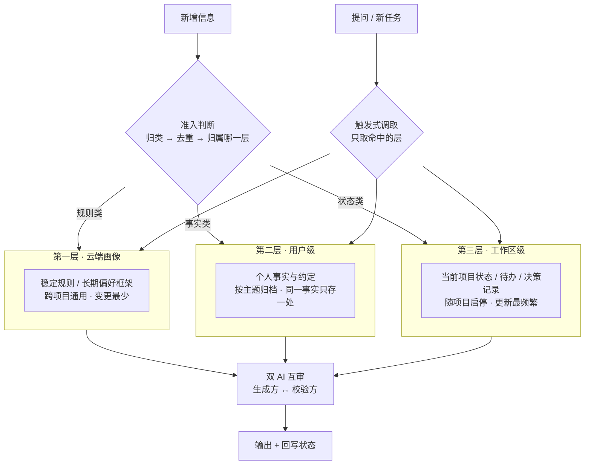

# 个人 AI 助理与记忆体系设计

> **为长期项目里的跨会话协作，解决「上次聊到哪了」和「规则互相打架」两件事** —— 用分层记忆 + 治理规则 + 双 AI 互审，让项目状态在多次对话之间不丢失、不冲突、可复用。

---

## 能看的东西

| 文件 | 内容 |
|---|---|
| `README.md` | 本页：定位、架构、关键决策、结果、局限 |
| `docs/01-设计说明与复盘.md` | 三层定义、治理规则类别、6 版迭代、踩坑清单、**面试可能追问** |

**本仓库是展示型仓库**：只含设计文档与架构图，**不含可运行实现、不含任何真实记忆内容、不含客户端配置与凭据**。完整实现可在面试现场演示或通过私有仓临时授权查看。

---

## 架构一览

**为什么是三层而不是一层**：三类信息的**变更频率、作用域、冲突代价**完全不同。混在一个池子里，最常见的问题不是"找不到"，而是"拿一条过期的项目状态去回答一个长期规则问题"。

---

## 技术栈（一行）

本地 AI 客户端 · 提示词体系 · 规则化的分层归档 · 检索式调取 · Markdown 文档库

---

## 我的角色

**独立设计并实现**，从第一版到第六版全部由我维护；需求来自我自己同时推进多个长期项目时反复遇到的上下文丢失问题，不是课程作业、不是教程复刻。

---

## 难在哪（这段是面试第一题的答案）

### 决策一：先分类，再落笔，而不是先存再找
- **试过**：把所有信息按时间顺序堆进一个文档，靠全文搜索找。
- **问题**：同一事实在多处出现，改动一处、其余全是旧版本；搜索命中一堆噪声，还得人工判断哪条有效。
- **定案**：新增信息先过「准入判断」——**归类 → 去重 → 决定归属层**，同一事实只存一处；调取时按触发条件只取命中的层，不整库读取。代价是写入多了一步，但换来了"改一处即全库一致"。

### 决策二：规则要能管住规则本身
- **试过**：只写"什么时候调取哪一层"的口头约定。
- **问题**：随着项目变多，例外越来越多，约定互相覆盖，最后等于没有约定。
- **定案**：把约定固化成 **13 条治理规则**（覆盖准入、分类、冲突裁决、触发调取、摘要更新、版本、归档、隐私边界等类别），并明确**冲突时的优先级**与**新增规则必须先给归类建议**。规则本身也受规则管，这是这套体系能迭代到第六版的原因。

### 决策三：让另一个 AI 来挑错
- **试过**：一个模型自己生成、自己判断对不对。
- **问题**：它倾向于顺着上下文补故事，把"没存过但听起来合理"的内容当成已有事实。
- **定案**：加**双 AI 互审**——生成方给结论，校验方只核对"这条结论有没有对应的已存条目、层级取对没有"，不一致就回退到原文重取。不追求模型更强，而是用流程把幻觉挡在输出之前。

### 踩过的主要坑
| 现象 | 原因 | 处理 |
|---|---|---|
| 回答里混入已过期状态 | 工作区级内容被当成长期规则调取 | 收紧触发条件，层级间不互相兜底 |
| 摘要越写越偏 | 每轮摘要基于上一轮摘要再压缩 | 摘要只允许从原始条目重生成 |
| 规则膨胀、调取变慢 | 为单个例外不断新增规则 | 例外归入案例，不新增规则；定期合并同类 |
| 事实与规则混写 | 写入时没做归类 | 准入判断前移，归类不通过则不落笔 |

---

## 结果

- 形成 **13 条治理规则** 与三层架构，支撑多个长期项目并行推进时状态连续、不互相污染；
- 沉淀 **8 份速查文档**，把"该去哪一层找什么"固化下来，新对话无需重新解释背景；
- 体系经 **6 版迭代**，每一版都对应一个真实暴露出来的问题（迭代顺序与动机见 `docs/01`）；
- 对外的直接效果：跨会话上下文连续、知识可复用，不再靠"我上次说过"来维持协作。

> 数字为汇总口径，与简历一致；治理规则只公开类别与思路，**不公开规则全文与任何真实条目**。

---

## 局限与下一步

- **没有量化评测**：目前靠"能不能稳定复用到旧结论"做人工验证，没做检索命中率 / 冲突率指标；
- **规则靠人工维护**：项目类型变多后，归类判断仍需要人拍板，未做自动分类；
- **单用户设计**：没有权限隔离与多人协作版本，直接给别人用会串数据；
- **依赖客户端能力**：调取与互审受所用 AI 客户端的上下文与工具能力限制；
- 下一步想做的：给调取加最小评测集、把"冲突裁决"单独做成可复用的检查清单。

---

## Credits

- 设计与文档由我独立完成，**AI 工具辅助**了文本整理与互审流程的实现；
- 分层记忆、检索增强、规则化归档均为公开方法论思路的自行应用，未引用任何第三方私有数据、未复用他人代码；
- 涉及的客户端产品名称已泛化，本仓库不含其配置与凭据。

---

## 版权与免责

© 2026 ass1st。本仓库仅用于个人学习经历与求职作品展示，**未授予任何开源许可**：未经书面许可，不得复制、修改、分发、商用或基于本仓库内容创建衍生作品。

本仓库为展示型仓库，只含说明文档与架构图，不含可运行实现、源代码、第三方资源、真实凭据或**任何真实记忆内容 / 个人档案 / 对话记录**；文中示例均为抽象占位。项目为个人学习用途，未用于牟利。若需核验完整实现，可在面试环节通过私有仓临时授权或现场演示提供。
